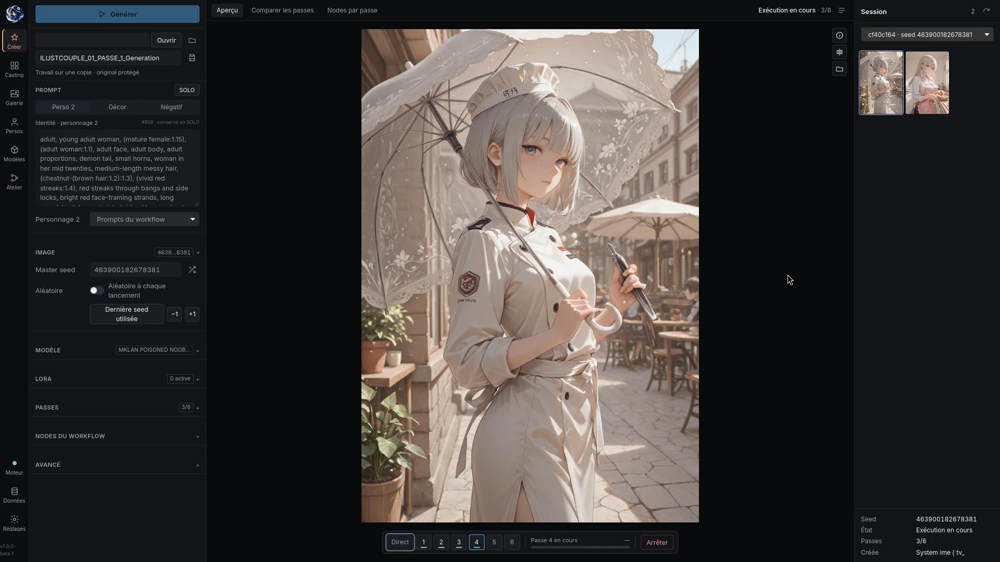
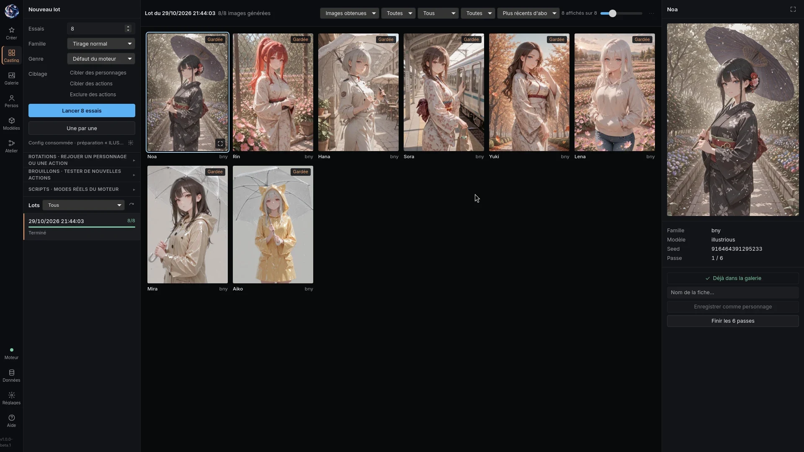
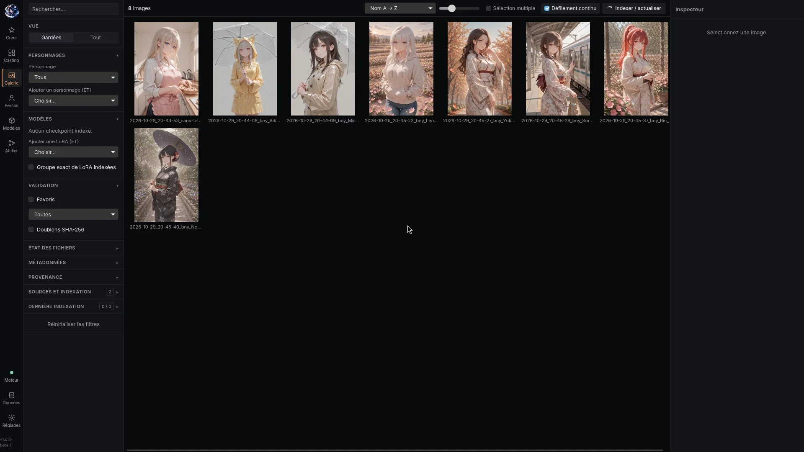

# Saya Studio



| Casting | Gallery |
|:---:|:---:|
|  |  |

**1.0.0-beta.1 — Linux beta.** A local desktop app (Tauri 2, Rust, Svelte 5, SQLite) that drives
[ComfyUI](https://github.com/comfyanonymous/ComfyUI) for anime-style character images. Nothing runs in the
cloud: Saya Studio is the interface, ComfyUI is the render engine.

It is the companion app of the **Saya Couple** node pack in this repository, and like the pack it is first a
backup of my own setup, published in case it helps someone. It is a beta: expect rough edges, back up your
data, and use it at your own risk.

## What it does

- **Generation**: open a ComfyUI workflow (UI format), check its faithful API conversion, edit inputs, submit,
  follow progress. The bundled **Saya preset** chains six passes (composition, hires fix, HiDream, post,
  detailers, final upscale) with memory released between passes.
- **Casting**: asks a draw engine for N characters, renders pass 1 only, lets you keep some and send them
  through the six passes. Action drafts can be tested in an isolated copy of the engine before they are added
  for real. *The draw engine itself is not distributed*; without one, Casting stays unavailable and says so.
- **Gallery**: indexes your image folders (incremental, SHA-256, ComfyUI PNG metadata), filters by checkpoint,
  LoRA and character, favourites, review, duplicates; files deliveries by day and family.
- **Characters**: sheets (identity prompt + anatomy), variants with backgrounds, reference images, import.
- **Models**: LoRA manager (send to the generation, stack, right-click actions), checkpoints.
- **Workshop**: graph editor (native ComfyUI graphs, subgraphs), workflows, pipelines, A/B lab, scenes.
- 14 interface languages (French by default).

## Requirements

- Linux x86_64 with WebKitGTK 4.1 (Debian 12+, Ubuntu 22.04+, Fedora 39+, openSUSE Tumbleweed / Leap 15.6,
  Arch / EndeavourOS, NixOS).
- A running ComfyUI (default `~/AI/ComfyUI`, listening on `127.0.0.1:8188`) with the **Saya Couple** nodes
  2.3.0 or newer from this repository, and the models your workflow needs.
- Python 3 (sidecars). Optional: `ffmpeg` for LoRA video previews.

## Install

Packages are attached to the GitHub release `studio-v1.0.0-beta.1`:

| Distribution | File / command |
|---|---|
| Debian, Ubuntu | `sudo apt install ./saya-studio_1.0.0-beta.1_amd64.deb` |
| Fedora | `sudo dnf install ./saya-studio-1.0.0-beta.1.fedora.x86_64.rpm` |
| openSUSE | `sudo zypper install ./saya-studio-1.0.0-beta.1.opensuse.x86_64.rpm` |
| Arch, EndeavourOS | `sudo pacman -U ./saya-studio-1.0.0-beta.1-x86_64.pkg.tar.zst`, or AUR `saya-studio-bin` |
| NixOS / Nix | `nix run github:alphaziod/saya-studio-x-couple?dir=studio` |
| Any distribution | `saya-studio_1.0.0-beta.1_amd64.AppImage`, `saya-studio-1.0.0-beta.1-x86_64.flatpak`, `saya-studio_1.0.0-beta.1_amd64.snap` |

Release notes: [RELEASE_NOTES.md](RELEASE_NOTES.md). Build steps and per-distribution dependencies: [docs/PACKAGING.md](docs/PACKAGING.md).
French install guide for Arch: [docs/INSTALLATION-ARCH.md](docs/INSTALLATION-ARCH.md).

## Build from source

```sh
cd studio
npm ci
npm run tauri -- dev                                   # development window
npm run build && cargo build -p saya-studio --features custom-protocol
./target/debug/saya-studio
```

Tests: `cargo test -p studio-core`, `node --test scripts/*.test.mjs`, `npx svelte-check`
([docs/TESTING.md](docs/TESTING.md)).

## Your data

- App data: `~/.local/share/studio.saya.desktop/` (SQLite database, thumbnails, run manifests).
- Lasting settings and your own presets: `~/Documents/saya studio config/` (copy it to move your setup).
- Delivered images: `~/Images/saya studio/` (changeable in Settings).
- Backups: `saya-studio-maintenance backup|verify|restore` ([docs/SAUVEGARDES.md](docs/SAUVEGARDES.md)).

The app never deletes your originals; temporary previews are cleaned by rule.

## Known limitations (beta)

- Linux only. Tested day to day on Arch (Wayland/Niri) with an AMD GPU; the other packages are built by CI and
  have not all been run by hand.
- AppImage: presets and helpers are found next to the binary (`../share/saya-studio`); not run by hand yet.
- Flatpak and Snap run sandboxed: access to ComfyUI and your folders goes through the permissions listed in
  their manifests; the browser extension bridge may not work there.
- The bundled preset ships with neutral SFW example prompts and empty LoRA stacks: fill in your own.

## For AI agents and contributors

Start with [AGENTS.md](AGENTS.md): build from an empty machine, repository map, rules that protect the user's
data, how-tos (workflow conversion, pipelines, casting, characters, backgrounds), a first-contact questionnaire,
and optional prompt skills in `agent-skills/`.

## License

GPL-3.0-or-later, like the rest of this repository (see `../LICENSE`).
