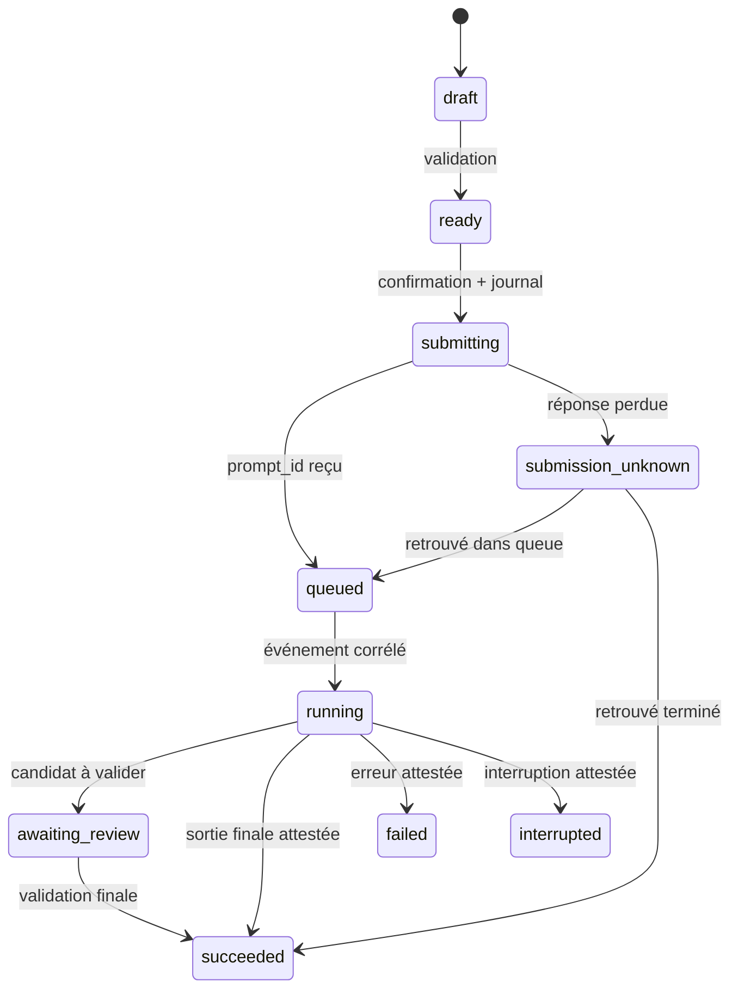

# Contrats d'API — v1

## Contrat implémenté : interface → Rust

`invoke('get_bootstrap')`, sans argument, renvoie :

```json
{"apiVersion":1,"appVersion":"0.1.0","schemaVersion":1,"counts":{"characters":0,"assets":0,"jobs":0},"comfyConnected":false,"implemented":["navigation","sqlite_migrations","local_status"]}
```

Les compteurs viennent de SQL, pas du fixture. Le fixture `contracts/bootstrap-v1.json` est utilisé uniquement par les tests. Une erreur rejette la Promise : `{code:"storage_unavailable",message:string,retryable:false}`. L'UI valide la forme reçue ; les valeurs inconnues/erreurs s'affichent comme telles, jamais comme zéro. En navigateur sans Tauri, aucun IPC n'est simulé. Actualiser relit les compteurs.

## Contrats futurs, NON exposés

Convention : camelCase IPC, IDs chaînes UUID, dates UTC RFC3339, seed chaîne décimale u64, valeurs optionnelles null explicite si connues comme absentes. Erreur commune `{code,message,retryable,details?}` ; détails bornés sans prompts ni contenu de fichier par défaut. Pas de commande générique SQL, shell, HTTP ou ouverture arbitraire de chemin.

| Commande prévue | Entrée | Sortie / condition |
|---|---|---|
| `preview_character_import` | `{sourceHandle, expectedSha256}` | `{previewId, sourceSha256, additions, conflicts, warnings}` ; lecture seule |
| `commit_character_import` | `{previewId, acceptedConflictDecisions}` | `{importId, imported, skipped}` ; rehash et transaction |
| `search_assets` | `{filter, cursor:null|string, limit:1..200}` | `{items,nextCursor}` ; ordre stable par ID, curseur opaque, filtres typés |
| `inspect_comfy` | `{endpoint:"http://127.0.0.1:8188"}` | `{serverVersion,nodeSchemaHash,capabilities,observedAt}` ; GET seulement |
| `validate_workflow_mapping` | `{revisionId, bindings, values}` | `{validationId,inputHash,issues,proposedApiHash}` ; aucune soumission |
| `prepare_generation` | `{revisionId,characterRevisions,promptBlocks,seed,resourceChoices}` | `{draftId,snapshotHash,validation,summary}` |
| `submit_generation` | `{draftId,expectedSnapshotHash,userConfirmed:true}` | `{jobId,state}` ; seconde vérification, persistance avant POST |
| `resume_from_pass` | `{sourceArtifactId,expectedContentHash,targetPhase,userConfirmed:true}` | nouveau `{jobId,parentJobId}` uniquement si capability vérifiée |
| `review_artifact` | `{artifactId,expectedTransactionId,decision,note}` | `{reviewId,status}` ; décision humaine, pas validation par heuristique |
| `propose_prompt` | `{fullPrompt,orderedBlocks,modelContext,loraContext}` | `{originalFullPrompt,proposedFullPrompt,changes,evidence,validated:false}` |

`sourceHandle` est un identifiant Rust issu d'une sélection autorisée, pas un chemin libre fourni par une métadonnée. `userConfirmed` est une protection contre les erreurs de flux UI, pas une authentification. Une commande future sensible doit être restreinte aux fenêtres locales et vérifier ses préconditions côté Rust.

Filtres : `{characters?:{ids,match:"any"|"all"},models?:{ids,match},loras?:{ids,match},loraGroups?:{ids,match,memberMatch:"any_member"|"all_members"},metadataState?}`. Ne pas déduire un personnage du seul nom de fichier.

Événement futur `studio://job-event` : `{apiVersion:1,eventId:string,jobId,sequence:number,type,at,payload}`. SQL reste la source de vérité. Une reconnexion UI relit un snapshot et récupère les événements après son curseur ; perdre une notification n'autorise aucune nouvelle génération.

## Workflow Adapter

Binding : `{semanticKey,graphPath:string[],nodeId,expectedClass,inputName,valueType}`. `graphPath` identifie la suite d'instances de subgraphs, pas seulement leur définition réutilisable. Pour un export API déjà aplati, chemin vide et nodeId exact (y compris `810:488` si l'export l'utilise).

Un adaptateur vérifie : hash de révision, format, node existant, classe attendue, input, type et liens avant modification d'une copie en mémoire. Il refuse un input piloté par un lien si le contrat attend une valeur littérale. Il valide les classes avec `/object_info` et conserve toutes entrées non mappées. Un diff et un hash du payload proposé sont rendus pour revue.

Le JSON UI LiteGraph (`nodes`, `links`, widgets, définitions) n'est pas le JSON API (`nodeId: {class_type,inputs}`). La position d'un widget ne suffit pas à identifier un input. Les nodes virtuels, bypassers, Set/Get, widgets LoRA et subgraphs peuvent participer à `graphToPrompt`. Version initiale future : export API fourni et vérifié seulement. Pas de conversion universelle silencieuse.

## Rust → ComfyUI (futur connecteur)

Endpoint par défaut loopback numérique, configurable explicitement. N'autoriser que HTTP/WS loopback dans la première tranche ; accès réseau distant exige un choix distinct. Refuser redirections hors endpoint, userinfo et URL extraite de métadonnée. Fixer timeouts, taille maximale des réponses et limite de reconnexion.

- GET `/system_stats` : identité et version ; GET `/object_info` : schémas installés (pas une preuve d'exécution).
- GET `/queue` et `/history/{prompt_id}` : réconciliation ciblée. Historique ComfyUI peut être vidé ou perdu ; conserver le propre journal Studio.
- WS `/ws?clientId=<uuid>` : événements corrélés au prompt_id ; `execution_cached` n'est pas une nouvelle image, `executing`/`executed` ne remplacent pas l'état final de l'historique. Déconnecter le socket ne doit pas interrompre le job. Messages binaires de prévisualisation bornés et non décodés comme JSON.
- POST `/prompt` : `{prompt:<API graph>,client_id:<uuid>,extra_data:<provenance>}`. Réponse `{prompt_id,number,node_errors}` ou erreur HTTP avec `{error,node_errors}`. Les champs optionnels `prompt_id` client et `/api/jobs` existent dans la source 0.34.0 auditée mais sont dépendants de version ; ne pas supposer l'idempotence du POST.
- GET `/view` : filename/subfolder/type issus d'une sortie validée ; valider type et traversée. Téléchargement seulement vers le propre espace du job après action explicite.

Aucun POST ComfyUI n'a été utilisé pendant cette mission. `/interrupt`, `/free`, modifications de queue et routes Saya de validation/déchargement sont des mutations à traiter séparément. Ne pas interrompre les tâches des autres clients.

## État de génération (à implémenter)



Les tentatives de reprise et d'annulation devront ajouter leurs transitions testées. `submission_unknown` reste bloqué sans preuve ; absence de queue/history ne prouve pas que le POST n'a jamais exécuté. Annuler un job en attente ciblé ≠ interrompre le serveur. Refaire une passe produit une nouvelle tentative ; reprendre une branche conserve parent_job_id.

## Rust → MCP (future intégration)

Configurer indépendamment executable/argv/env autorisés ; pas de dépendance à la configuration Grok. Initialiser la session MCP, négocier version, découvrir tools/list et appeler tools/call. Stdio réservé au protocole, stderr borné pour diagnostics. Interdire commandes shell composées, téléchargement implicite et transmission externe. Fermer stdin/process à la sortie, timeout/annulation explicites.

Le MCP existant possède sa propre mémoire SQLite ; ne pas écrire directement dans ses tables. Référencer ses IDs d'expériences via une réponse documentée. Les règles de conservation des tags/blocs restent des invariants à retester lors de chaque proposition ; une optimisation n'est jamais validée sur simple réponse du modèle.
