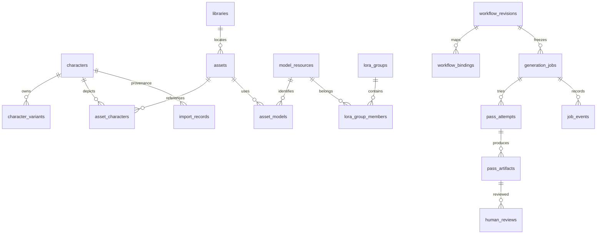

# Modèle SQLite v1

Source exécutable : `migrations/0001_initial.sql`. Base créée uniquement par Saya Studio dans son propre app_data_dir, jamais dans ComfyUI/GROK BUILD/le pack. Version dans `PRAGMA user_version` et `schema_migrations`. Aucun enregistrement métier initial.

## Relations



Les IDs métier seront des UUID générés côté Rust. v1 stocke TEXT et ne vérifie pas la syntaxe UUID en SQL ; le futur domaine doit la valider. `import_records.source_key` conserve l'ID historique (ne jamais remplacer l'identité interne par un label ou un index de tableau).

## Objets

| Tables | Contenu / invariant |
|---|---|
| characters / character_variants | identité stable versionnée, variantes séparées ; archiver au lieu de supprimer une identité référencée |
| libraries / assets | une référence par racine+chemin ; hash facultatif, présence distincte de la validité des métadonnées |
| asset_characters / asset_models | relations recherchables, nature de preuve obligatoire ; une inférence n'est pas une validation humaine |
| model_resources / lora_groups / lora_group_members | ressources avec famille inconnue possible ; triggers interdisent l'insertion/modification d'un membre non-LoRA |
| workflow_revisions / workflow_bindings | contenu JSON et hash d'origine, format API/UI explicite, mapping par graphe/node/input/classe |
| generation_jobs / pass_attempts / pass_artifacts | job snapshot, tentative numérotée, artefacts typés ; parent_job_id pour branche de reprise |
| human_reviews / job_events | décisions humaines et événements historiques séparés du statut d'un fichier |
| import_records | source/hash/clé pour importer de façon idempotente une révision donnée |

Aucun `ON DELETE CASCADE` : supprimer un parent référencé échoue. Ces tables préparent les domaines ; aucune commande CRUD n'est encore exposée.

## Documents JSON versionnés (contrats de domaine futurs)

Chaque snapshot inclura `schemaVersion: 1`. `json_valid` contrôle la syntaxe, **pas le schéma métier** : la validation structurée Rust est une condition préalable à tout futur writer.

`identity_json` : `{schemaVersion, identityPrompt, anatomyPrompt, negativeExtra, traits, sourceEvidence}`. Ne pas fusionner `identity_prompt` et le champ historique `prompt` sans règle d'import montrée à l'utilisateur.

`prompt_blocks_json` : `{schemaVersion, blocks:[{key,text}]}`. Tableau ordonné, texte exact, blocs inconnus conservés. Clés prévues : QUALITY, P1, P1_ANATOMY, P2, P2_ANATOMY, ACTION, BG, NEG. Distinction entre champ absent et vide. Ce format ne prétend pas être accepté tel quel par le MCP existant ; traduction à tester ultérieurement.

`request_snapshot_json` : révisions de personnages, blocs complets, seed chaîne, workflow/adapter hashes, ressources+forces MODEL/CLIP et preuve de trigger, options, résolution, règles de tirage/version/seed et choix résolus. Aucune référence mutable seule ne suffit à rejouer un job.

`effective_parameters_json` : paramètres effectivement observés, identifiant prompt ComfyUI, provenance (`submitted`, `history`, `embedded`, `human`), inconnues explicites. Paramètre widget ≠ paramètre exécuté.

`manifest_json` : enveloppe Studio `{schemaVersion, producer, producerVersion, sourceTransactionId, sourceManifest, files, dependencies, verification}`. Garder intact le manifeste Saya brut ; le versionnement Studio ne rend pas le format producteur versionné rétroactivement.

## Recherche combinable

AND entre catégories : modèle ET personnage ET LoRA ET groupe. Dans une sélection de plusieurs IDs d'une même catégorie, `match: any|all` explicite. Pour un groupe, `any_member|all_members` explicite ; groupe vide rejeté comme filtre. Les membres sont résolus au moment de la recherche. Snapshot des membres au moment d'une génération.

Index v1 sur relations inverses personnage/modèle, hashes d'assets et état/date des jobs. Exemple de filtre avec deux critères (valeurs bindées, jamais SQL issu de l'UI) :

```sql
SELECT a.id,a.relative_path FROM assets a
WHERE EXISTS (SELECT 1 FROM asset_characters c
              WHERE c.asset_id=a.id AND c.character_id=?1)
  AND EXISTS (SELECT 1 FROM asset_models m
              WHERE m.asset_id=a.id AND m.model_id=?2)
ORDER BY a.id LIMIT ?3;
```

## Garanties présentes / futures

Présent : transaction de migration, refus de downgrade et de base non versionnée inconnue, FK, contraintes de statut, JSON, seed u64 canonique, membres LoRA, persistance à la réouverture. Les compteurs exposés sont des u32 (au-delà, erreur explicite de lecture).

Futur obligatoire : application_id/checksums avant migrations multiples, sauvegarde et restauration, état de job à transitions contrôlées, append-only métier des révisions/events/reviews, validation des chemins, anti-collision des jobs et schémas JSON. La base v1 n'empêche pas à elle seule une transition incohérente vers `succeeded` ou `validated` ; seule une future couche métier pourra autoriser ces transitions avec preuves. Aucun writer métier n'est livré.
